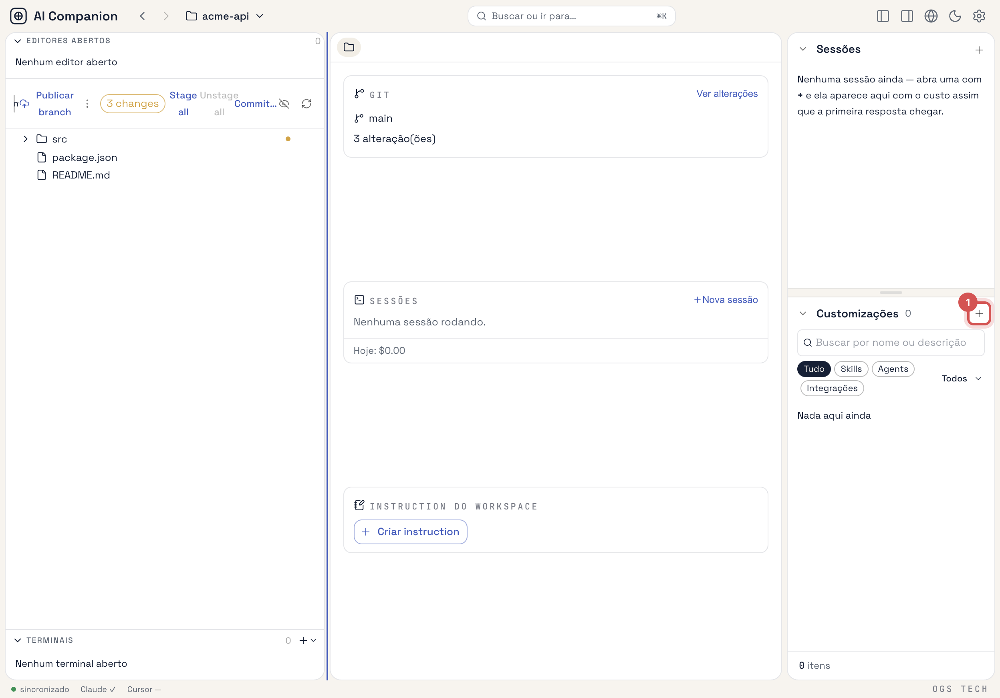
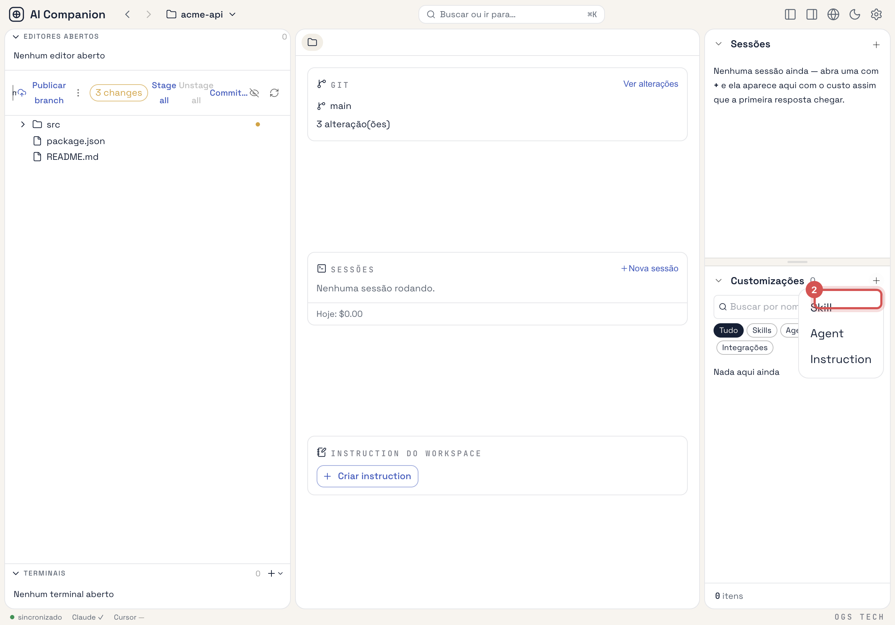
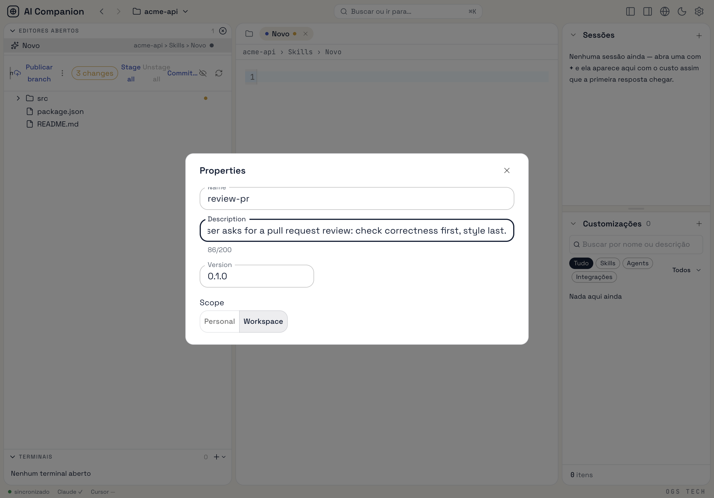
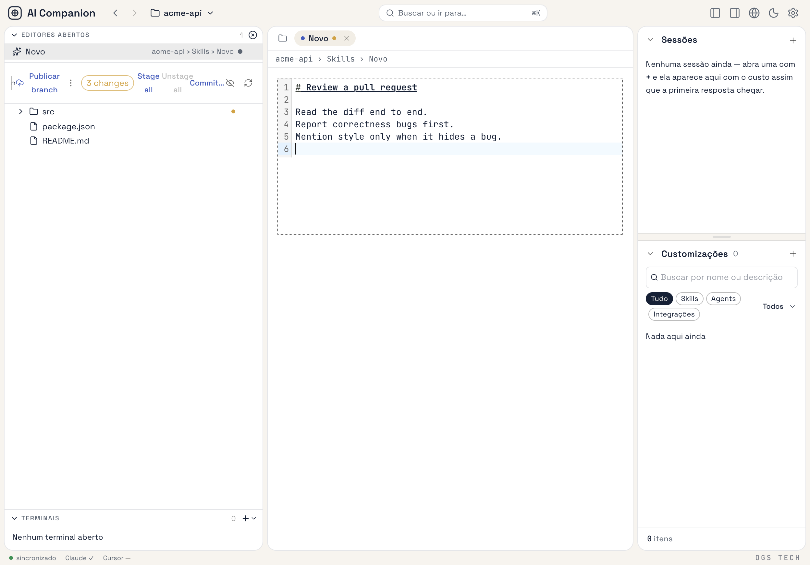
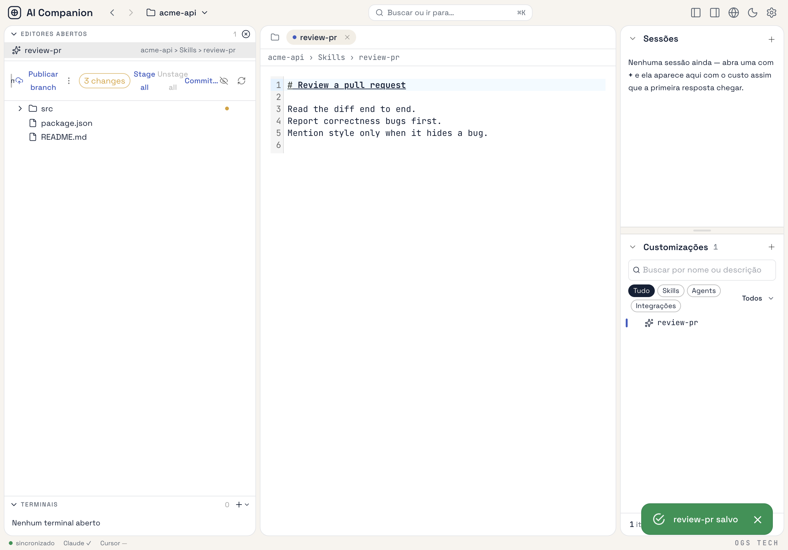

# Create skills, slash-commands and agents

Skills and agents are edited the same way. A **slash-command** is a skill the model may not invoke on its
own — there is no separate kind for it. Field rules (name format, length limits) are in
[Entity schema](../reference/customization-schema.md); where each one lands on disk is in
[Adapter targets](../reference/adapter-targets.md).

## Create one

1. In the right panel (the **PanelRight** toggle in the TopNav shows it if hidden), click **+**
   (**Novo**) in the **Customizações** header and choose **Skill** or **Agent**.

   

   

2. A new tab opens with a **Properties** dialog. Fill in:
   - **Name** — lowercase letters, digits and hyphens, starting with a letter or digit
     (`^[a-z0-9][a-z0-9-]*$`). It becomes the folder/file name in every harness.
   - **Description** — up to 200 characters. For a skill, this is what the model reads to decide when
     to use it, so describe the trigger, not the content.
   - **Version** — free-form; informational.
   - **Scope** — **Personal** (all your repos) or **Workspace** (the open workspace's folder). **Workspace**
     is only available while a workspace is open, not on Início.

   

3. Close the dialog and write the body in the editor: the skill's instructions, or the agent's system prompt.

   

4. Press **⌘S** (Ctrl+S). There is no save button; the tab shows a dirty marker until saved.

   

On save the canonical file is written to the data dir of its scope and linked into every enabled harness.
If any target needed overwriting, a **Sync report** dialog lists it with the path of the backup.

## Edit, preview, rename

- **Edit:** click the row. The tab reopens on the current file.
- **Preview:** right-click the row → **Preview** renders the body as Markdown, read-only.
- **Properties:** right-click → **Properties** reopens the form.
- **Rename:** change **Name** and save. The old file and its links are removed and the new ones created.

> **Changing Scope without renaming leaves the old link behind.** Save only cleans up previous
> destinations on a rename, so moving `my-skill` from Personal to Workspace keeps
> `~/.claude/skills/my-skill` in place next to the new `<workspace>/.claude/skills/my-skill`. Delete the
> stale link by hand, or rename and rename back.

## Make a skill a slash-command

The editor has no control for this yet. Set it in the canonical file's frontmatter:

1. Close the skill's tab if it is open (saving from a tab opened before your edit would overwrite it).
2. Open `<data dir>/skills/<name>/SKILL.md` — `~/.ai-companion/skills/<name>/SKILL.md` for a personal
   skill, `<workspace>/.ai-companion/skills/<name>/SKILL.md` for a workspace one — in any editor.
3. Add to the frontmatter:

   ```yaml
   disable-model-invocation: true
   ```

4. Save the file. The app's file watcher picks it up and re-syncs; no restart needed.

In Claude Code, invoke it as `/<name>`. Later saves from the app preserve the flag
(it round-trips as `explicitOnly: true`).

## Delete one

Hover the row and click the trash icon (**Excluir**). The canonical file and every link the app created for
it are removed. Plugin-provided entries are read-only and have no delete action — manage them from
[their plugin](install-plugins-and-marketplaces.md).

## Use it in a session right away

Right-click the row → **New Action**. A fresh `claude` session opens in the entity's scope with
`@<path-to-the-entity>` drafted (not sent) as the first message, so you can ask the agent to work on it.
See [Run and review sessions](run-and-review-sessions.md).
