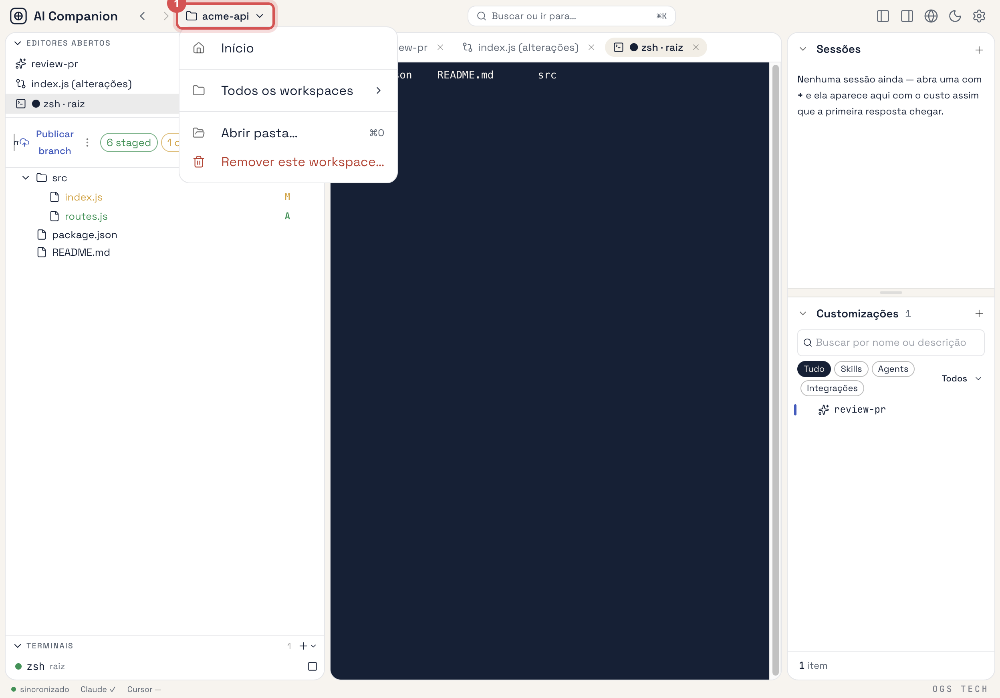

# Manage workspaces

A **workspace** is a folder you opened in the app. It has its own data dir, `<folder>/.ai-companion/`,
holding the skills, agents and instructions scoped to it. **Início** is not a workspace: it is the
Global context (`~/.ai-companion/`), where `personal` entities live and where nothing folder-specific —
Git, launch configurations, the file tree — is available. Background:
[Architecture → Global / Workspace](../reference/architecture.md) and
[On-disk layout](../reference/on-disk-layout.md).

## Open a folder as a workspace

Any of these opens the native folder picker:

- **Início** → **Abrir pasta…** on the **Recentes** card.
- The context switcher in the TopNav (the `🏠 Início ▾` / `📁 name ▾` button) → **Abrir pasta…**.
- **⌘O**, or **Abrir pasta…** in the command palette (**⌘K**).

The workspace is named after the folder, `<folder>/.ai-companion/` is created, and the app switches to
it. You cannot open your home folder as a workspace — that is what Início is for.

## Switch between workspaces and Início

Click the context switcher in the TopNav:

- **Início** — back to the Global context.
- **Recentes** — the workspaces you opened last.
- **Todos os workspaces** — every registered workspace.

Switching stops every running `claude` session and launched process of the outgoing workspace and closes
its embedded browser tabs; open sessions do not carry over. If a tab has unsaved changes you are asked
before they are discarded. Symlinks already written to `~/.claude/` and `~/.cursor/` are **not**
re-pointed — see [Adapter targets → Known issues](../reference/adapter-targets.md#known-issues).

On **Início**, the **Workspaces** area in the left panel lists every workspace with its path; click a row
to switch to it.

## Remove a workspace

With the workspace open, open the context switcher → **Remover este workspace…**. The app returns to
Início first, then removes it.

Removal only drops the workspace from `workspaces.json`: its `<folder>/.ai-companion/` dir, its entities
and any symlinks they produced stay on disk. Delete the dir by hand if you want it gone. Your folder and
its files are never touched.

## Filter customizations by origin

Inside a workspace, **Customizações** lists the workspace's own entities together with the personal ones
inherited from Início (tagged `global` at the end of the row). The **Origem** button switches between
**Todos**, **Meus** and **Plugins** (entities provided by installed plugins, read-only).

## See also

- [On-disk layout](../reference/on-disk-layout.md) — what each workspace stores and where.
- [Write instructions](write-instructions.md) — the personal instruction and per-workspace instructions.
