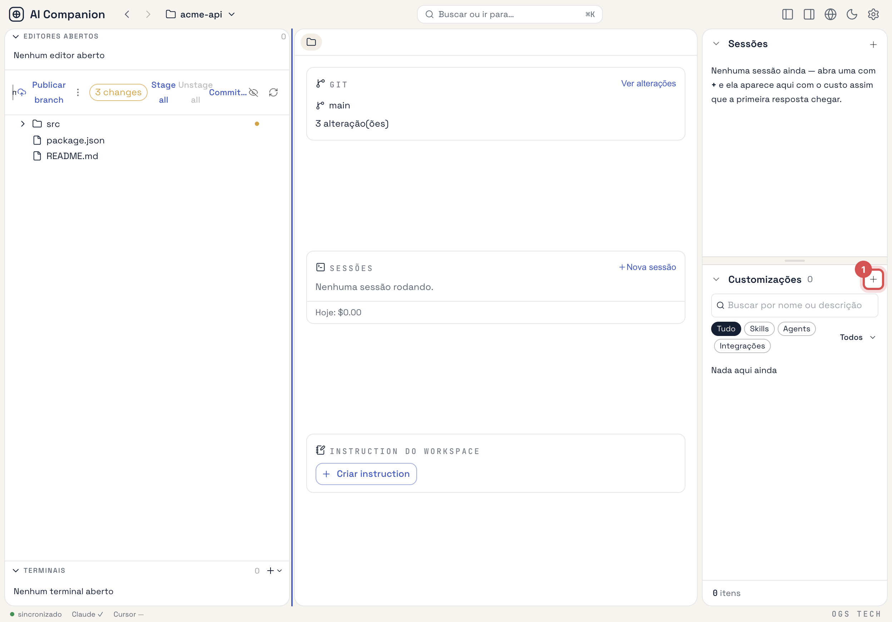
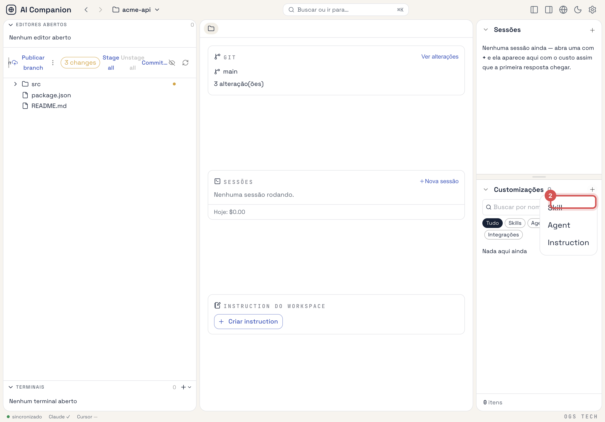
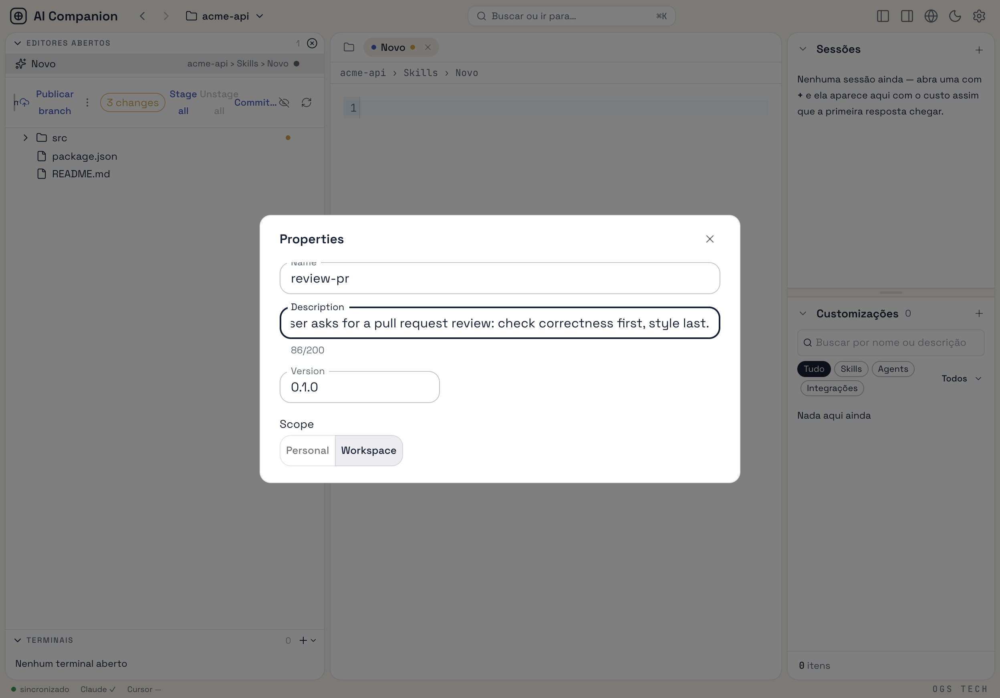
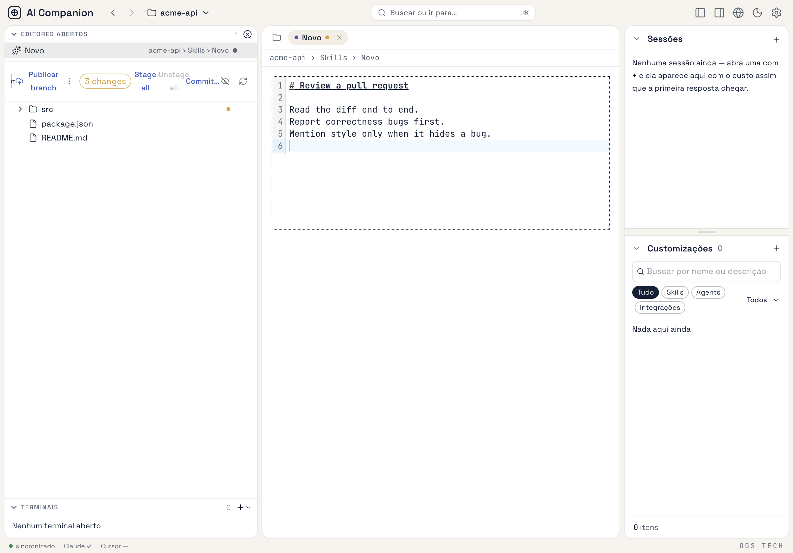
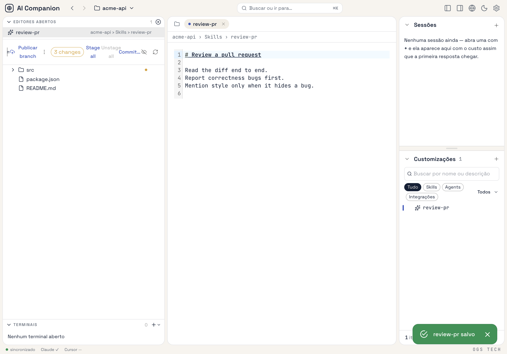

# Create skills, slash-commands and agents

Skills and agents are edited the same way. A **slash-command** is a skill the model may not invoke on its
own — there is no separate kind for it. Field rules (name format, length limits) are in
[Entity schema](../../technical/reference/customization-schema.md); where each one lands on disk is in
[Adapter targets](../../technical/reference/adapter-targets.md).

## Create one

1. In the right panel (the **PanelRight** toggle in the TopNav shows it if hidden), click **+**
   (**Novo**) in the **Customizações** header and choose **Skill** or **Agent**.

   

   

2. A new tab opens with a **Properties** dialog. Fill in:
   - **Name** — lowercase letters, digits and hyphens, starting with a letter or digit
     (`^[a-z0-9][a-z0-9-]*$`). It becomes the folder/file name in every harness.
   - **Description** — up to 200 characters. For a skill, this is what the model reads to decide when
     to use it, so describe the trigger, not the content.
   - **Version** — free-form; informational.
   - **Scope** — **Personal** (all your repos) or **Workspace** (the open workspace's folder). **Workspace**
     is only available while a workspace is open, not on Início. In a multi-folder workspace, **Novo** creates
     the item in the workspace's shared set
     (see [Work with multi-folder workspaces](../workspaces/work-with-multi-folder-workspaces.md)).

   

3. Close the dialog and write the body in the editor: the skill's instructions, or the agent's system prompt.

   

4. Press **⌘S** (Ctrl+S). There is no save button; the tab shows a dirty marker until saved.

   

On save the canonical file is written to the data dir of its scope and linked into every enabled harness.
If any target needed overwriting, a **Sync report** dialog lists it with the path of the backup.

## Read the Customizações tree

At Início the panel lists Global's items. Inside a workspace it has two sections: **Workspace** (the open
workspace's own items, and what was detected in its folders), then **Global** (Início's items, collapsed and
read-only here — tooltip *Somente leitura aqui — edite no Início*; edit them from Início).

Each section starts with its **Instructions** row, then one group per type: **Skills**, **Agents**, **MCP**,
**Hooks**, **Plugins**. A group with nothing in it is not shown, except **Skills** and **Agents** in the scope's
own list, which read *Nada aqui ainda*. Hooks have no workspace scope, so inside a workspace they all sit under
**Global**. A plugin is one row; click it to see what it provides. What a plugin provides is not listed again in
the type groups.

In a multi-folder workspace the folder is a tag on the row (`commit-msg · api`), not a level of the tree, and
each folder has its own **Instructions · <folder>** row.

Every item is in one of three states. A row speaks only when it is not installed; silence means it is:

| State | Row shows | Meaning |
|---|---|---|
| **Instalado** | nothing | It reached every channel that is on. |
| **Draft** | `draft · importar` | Found in Claude's or Cursor's own files, not yet managed by the app. Click the tag to import it. |
| | `draft · conflito Cursor` | A file the app doesn't manage is where the item goes in that channel, so the sync won't overwrite it. Click to open Diagnósticos. |
| | `draft · desativado` | You turned it off (an MCP server, a hook or a plugin). It goes to no channel. |
| **Com erro** | `⚠ Claude · Cursor` | Something is wrong in those channels (missing, out of date, needs sign-in). Click it to open Diagnósticos on the item. |

An error in one channel outranks a draft in another: the row shows the error.

Under the search box, the chips **Todos** · **Instalado N** · **Draft N** · **Com erro N** keep only the rows in
that state. With **Draft** or **Com erro** on, a second row (**Todos** · **Claude N** · **Cursor N**) narrows it to
one channel. They combine with the search, and each count is what selecting the chip shows. A chip at 0 is
disabled. The states are checked when the app opens or reloads, when you switch between Início and a workspace,
and after you change something — not on a timer. The footer reads `N itens, G do Global`; while a search or chip is active it reads
`n de N itens` with **Limpar filtros**, which clears both. Switching between Início and a workspace resets the
search and the chip.

- A green **N sessões** beside a skill, agent or MCP server means running sessions used it in the last ten
  minutes; hover for the list.
- Open a skill, agent or instruction's **Properties** (or edit an MCP server) to see **Sincronização**: for
  each channel, where the item lands and how (`Ligado por link simbólico`, `Arquivo gerado`,
  `Entrada em mcp.json`), or what is wrong there with **Abrir diagnóstico**. A channel that is off reads
  *Desativado*; LM Studio reads *Só roda sessões, não recebe customizações*.

## Edit, preview, rename

- **Edit:** click the row. The tab reopens on the current file.
- **Preview:** right-click the row → **Preview** renders the body as Markdown, read-only.
- **Properties:** right-click → **Properties** reopens the form.
- **Rename:** change **Name** and save. The old file and its links are removed and the new ones created.

> **Changing Scope without renaming leaves the old link behind.** Save only cleans up previous
> destinations on a rename, so moving `my-skill` from Personal to Workspace keeps
> `~/.claude/skills/my-skill` in place next to the new `<workspace>/.claude/skills/my-skill`. Delete the
> stale link by hand, or rename and rename back.

## Make a skill a slash-command

The editor has no control for this yet. Set it in the canonical file's frontmatter:

1. Close the skill's tab if it is open (saving from a tab opened before your edit would overwrite it).
2. Open `<data dir>/skills/<name>/SKILL.md` — `~/.air-ide/skills/<name>/SKILL.md` for a personal
   skill, `<workspace>/.air-ide/skills/<name>/SKILL.md` for a workspace one — in any editor.
3. Add to the frontmatter:

   ```yaml
   disable-model-invocation: true
   ```

4. Save the file. The app's file watcher picks it up and re-syncs; no restart needed.

In Claude Code, invoke it as `/<name>`. Later saves from the app preserve the flag
(it round-trips as `explicitOnly: true`).

## Delete one

Hover the row and click the trash icon (**Excluir**). The canonical file and every link the app created for
it are removed. Plugin-provided entries are read-only and have no delete action — manage them from
[their plugin](install-plugins-and-marketplaces.md).

## Use it in a session right away

Right-click the row → **New Action**. A fresh `claude` session opens in the entity's scope with
`@<path-to-the-entity>` drafted (not sent) as the first message, so you can ask the agent to work on it.
See [Start and manage sessions](../sessions/start-and-manage-sessions.md).
