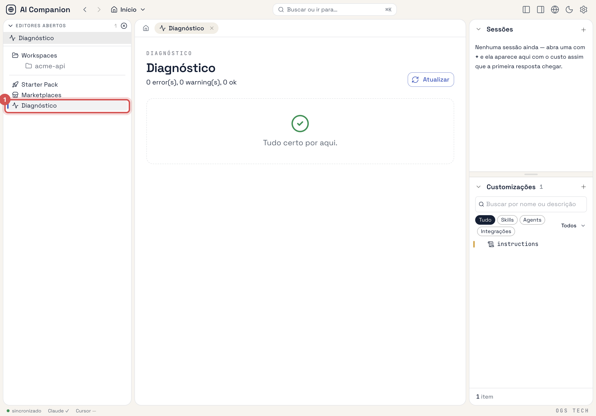

# Diagnose and reset

## Check overall health

The diagnostics entry on the right of the status bar (bottom of the window) names the worst state of the latest
health report: **Conectado**, **N em alerta** or **N com erro**. Click it for a summary: the customizations with a
problem (click one to open Diagnóstico on it), **Atualizar** and **Abrir diagnóstico**. Diagnóstico is also in
Início's left panel.

 When a new error appears, the app also sends a
macOS notification.

**Diagnóstico** is a matrix: one row per synced customization, grouped like the Customizações tree (Instruções,
Skills, Agents, MCP, Hooks, Plugins), and one column per channel that is on. Each cell says one of three things:

| State | Meaning |
|---|---|
| **Conectado** | The channel holds exactly what the app installed (or, for a channel that reads another channel's file, that file is fine). |
| **Em alerta** | Something outside the app changed or blocks it — a drifted file, a file of yours in the way, an MCP server waiting for sign-in, plugin drift. |
| **Com erro** | What the app installed is gone or broken — a missing or repointed link, a missing entry, a server that fails to start. |
| **—** | Nothing was checked there (for instance a server only Claude runs). |

A plugin shows the worst state of its own checks and of its MCP servers, listed under it. **Click a cell** to see,
under its row, what happened, the path (and where a link should point), when it was checked, and the one action
that fixes that cause:

| Cause | Action |
|---|---|
| Link or file missing, link pointing elsewhere, file or entry edited outside the app | **Sincronizar \<canal\>** — re-syncs that whole channel (backups for anything replaced). |
| A file of yours at the destination | **Instalar por cima** — moves it to `_backups/`, with **Desfazer** in the toast. |
| MCP server waiting for sign-in / failing | **Entrar** / **Abrir MCP** — opens the server's page ([MCP how-to](../../customizations/how-to/configure-mcp-servers-and-hooks.md#fix-a-server-that-needs-authentication)). |
| Plugin drift, an unreadable plugin file, an entry of yours in a shared JSON file | No button: a hint says what to do by hand. |

**Atualizar** syncs every channel, re-probes the MCP servers, scans the channels again for items you can import,
and re-runs every check; a summary line says when it synced, what it replaced with a backup and how many detected
items are waiting in the tree's **Detectados** filter.

Symlink and generated-file checks cover the **active workspace's** entities only.

## Recover a file the app overwrote

Whenever a sync replaces an existing file, the previous content is copied first to
`<data dir>/_backups/<timestamp>/<original path>` (`~/.air-ide/_backups/…` for personal entities),
and the **Sync report** shown after the save names the exact path. Copy what you need back by hand —
for example, into the body of the instruction that replaced it. Backups are never deleted automatically.

## Re-read files changed outside the app

The file tree, previews and lists refresh by themselves when the app's own data changes. If something you
edited elsewhere still looks stale, use **Reler do disco** (refresh icon) next to the **Arquivos | Git** toggle in the left panel.

## Start over by hand

The app has no reset button — it was removed because a button can only undo what the app *knows* it
created, and it left hooks and MCP entries behind (the **MCP** and **Hooks** groups still showed them). Wiping by
hand is explicit about what goes. Quit the app first, then work through this list; every step is optional,
pick the depth you want.

1. **Turn off the signal hooks first.** Open **Config → Sessões** and revoke "Ver o estado exato de
   sessões fora do app" (or set it to "só estimado"). That removes the app's `signals` hooks from
   `~/.claude/settings.json` and `~/.cursor/hooks.json`. If you skip this, those hooks stay in the files
   and keep showing up under **Hooks** as items detected in Claude and Cursor.
2. **Copy `~/.air-ide/_backups/` somewhere else** if you might need the files the app overwrote.
3. **Delete the app's links and generated files** in each harness's config surface — the list is in
   [Adapter targets](../../../technical/channels/reference/adapter-targets.md). In short: symlinks under
   `~/.claude/` (`skills/`, `agents/`, `CLAUDE.md`) and `~/AGENTS.md` that point into `~/.air-ide/`;
   `~/.cursor/plugins/air-ide/`; and, in every workspace folder you opened, the same symlinks under
   `<folder>/.claude/` and `<folder>/.cursor/`, plus `<folder>/.cursor/rules/*.mdc` files carrying the
   app's marker. Check with `ls -l` that a link points into `.air-ide` before removing it — never delete a
   real file you wrote yourself.
4. **Remove the MCP and hook entries the app merged** into `~/.claude.json`, `~/.claude/settings.json`,
   `~/.cursor/mcp.json`, `~/.cursor/hooks.json` and each folder's `.mcp.json` / `.cursor/{mcp,hooks}.json`.
   `~/.air-ide/merge-index.json` lists which entries are the app's. Entries you added yourself stay.
5. **Clear plugin registrations** (optional): `enabledPlugins` and `extraKnownMarketplaces` in
   `~/.claude/settings.json`, and the symlinks in `~/.claude/plugins/cache/local/`. These keys also hold
   what you added from Claude Code itself, so edit rather than empty them if that matters.
6. **Delete the data dirs:** `rm -rf ~/.air-ide` and, for each workspace you want to forget,
   `<folder>/.air-ide`. Your project files are untouched.
7. **Optional:** delete `~/Library/Application Support/<app name>/credentials.enc` to drop the stored
   GitHub token.

The next launch starts from scratch and re-seeds the official marketplace. Details of every path:
[On-disk layout](../../../technical/architecture/reference/on-disk-layout.md#removing-the-apps-footprint-by-hand).
