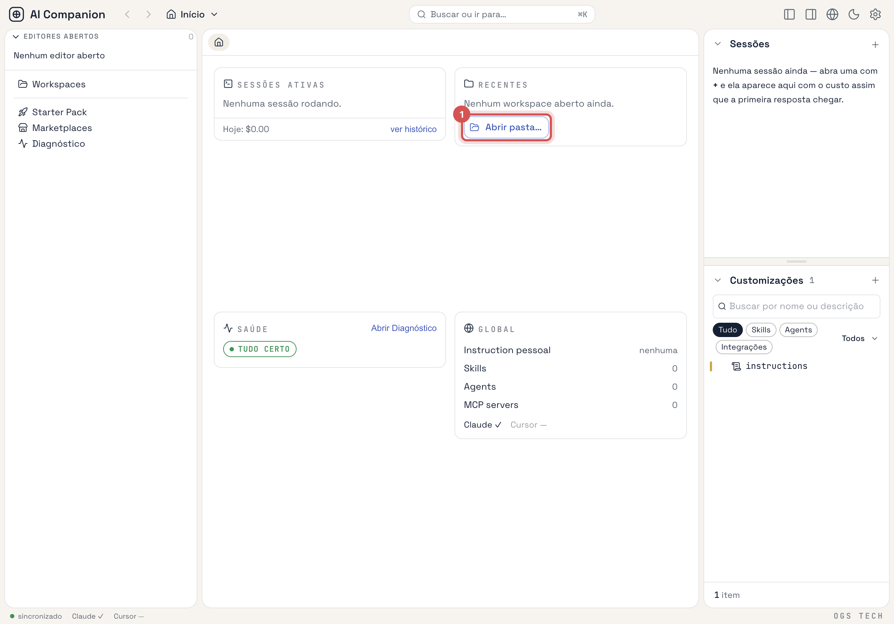
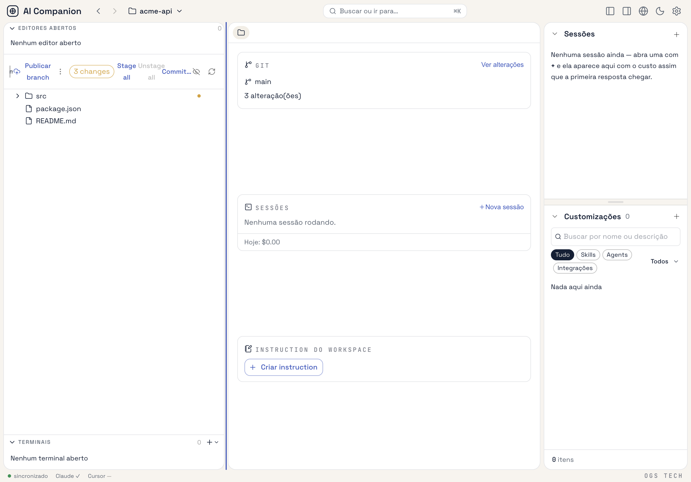
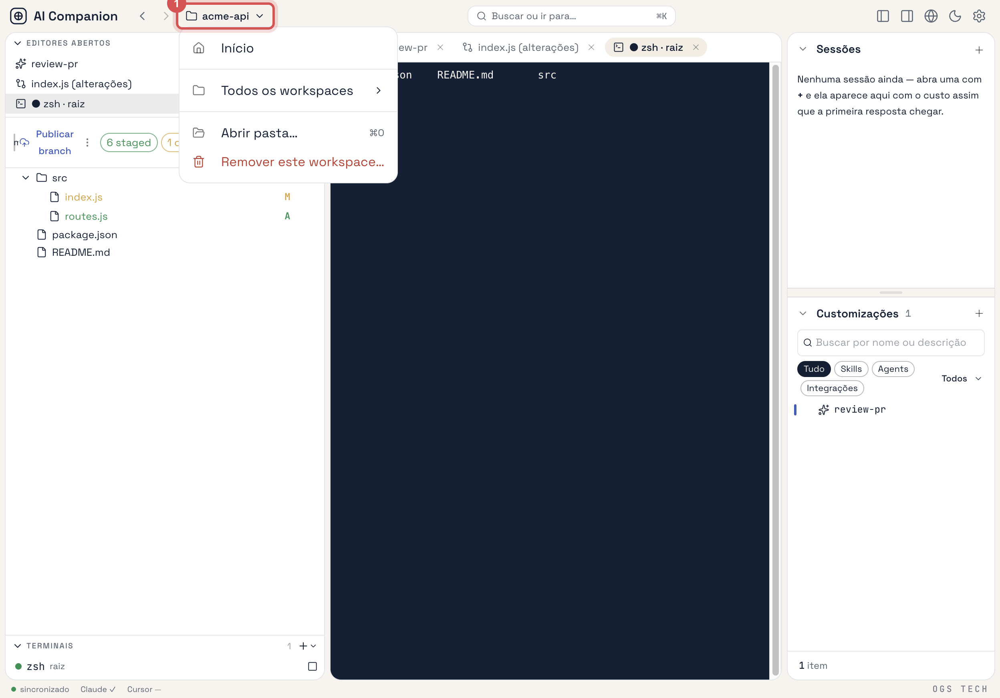

# Manage workspaces

A **workspace** is one or more folders you opened in the app. Each folder has its own data dir,
`<folder>/.ai-companion/`, holding the skills, agents and instructions scoped to it; to group several
repositories see [Work with multi-folder workspaces](work-with-multi-folder-workspaces.md). **Início** is not a workspace: it is the
Global context (`~/.ai-companion/`), where `personal` entities live and where nothing folder-specific —
Git, launch configurations, the file tree — is available. Background:
[Architecture → Global / Workspace](../../technical/reference/architecture.md) and
[On-disk layout](../../technical/reference/on-disk-layout.md).

## Open a folder as a workspace

Any of these opens the native folder picker:

- **Início** → **Abrir pasta…** on the **Recentes** card.
- The context switcher in the TopNav (the `🏠 Início ▾` / `📁 name ▾` button) → **Criar workspace…**.
- **⌘O**, or **Abrir pasta…** in the command palette (**⌘K**).

The workspace is named after the folder, `<folder>/.ai-companion/` is created, and the app switches to
it. You cannot open your home folder as a workspace — that is what Início is for.

## Switch between workspaces and Início

Click the context switcher in the TopNav:

- **Início** — back to the Global context.
- **Recentes** — the workspaces you opened last.
- **Todos os workspaces** — every registered workspace.

Sessions of the outgoing workspace keep running in the background; terminals, launched processes and
embedded browser tabs of the outgoing workspace are closed. If a tab has unsaved changes you are asked
before they are discarded. Symlinks already written to `~/.claude/` and `~/.cursor/` are **not**
re-pointed — see [Adapter targets → Known issues](../../technical/reference/adapter-targets.md#known-issues).

On **Início**, the **Workspaces** area in the left panel lists every workspace with its path; click a row
to switch to it.

## Remove a workspace

With the workspace open, open the context switcher → **Remover este workspace…**. The app returns to
Início first, then removes it.

Removal only drops the workspace from `workspaces.json`: its `<folder>/.ai-companion/` dir, its entities
and any symlinks they produced stay on disk. Delete the dir by hand if you want it gone. Your folder and
its files are never touched.

## See what a workspace inherits

Inside a workspace, **Customizações** lists the workspace's own entities under **Workspace** and, below a
divider, the personal ones inherited from Início under **Global** (collapsed, read-only). Plugin-provided
entities are grouped under their plugin and are read-only too. How the tree is organised:
[Create skills, slash-commands and agents → Read the Customizações tree](../customizations/create-skills-and-agents.md#read-the-customizações-tree).

## See also

- [On-disk layout](../../technical/reference/on-disk-layout.md) — what each workspace stores and where.
- [Work with multi-folder workspaces](work-with-multi-folder-workspaces.md) — several folders in one workspace.
- [Write instructions](../customizations/write-instructions.md) — Global, workspace and folder instructions.
