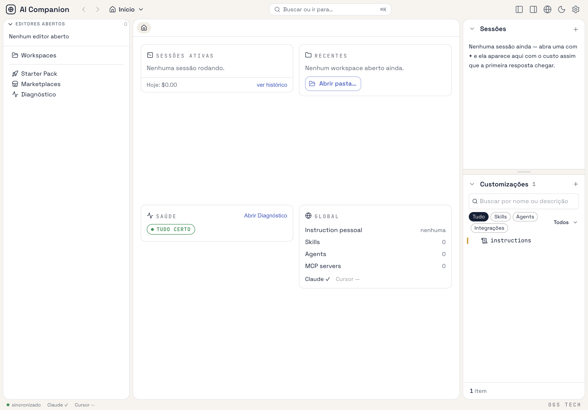
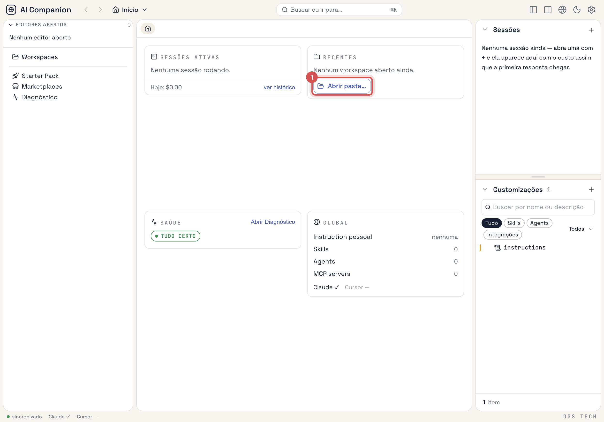
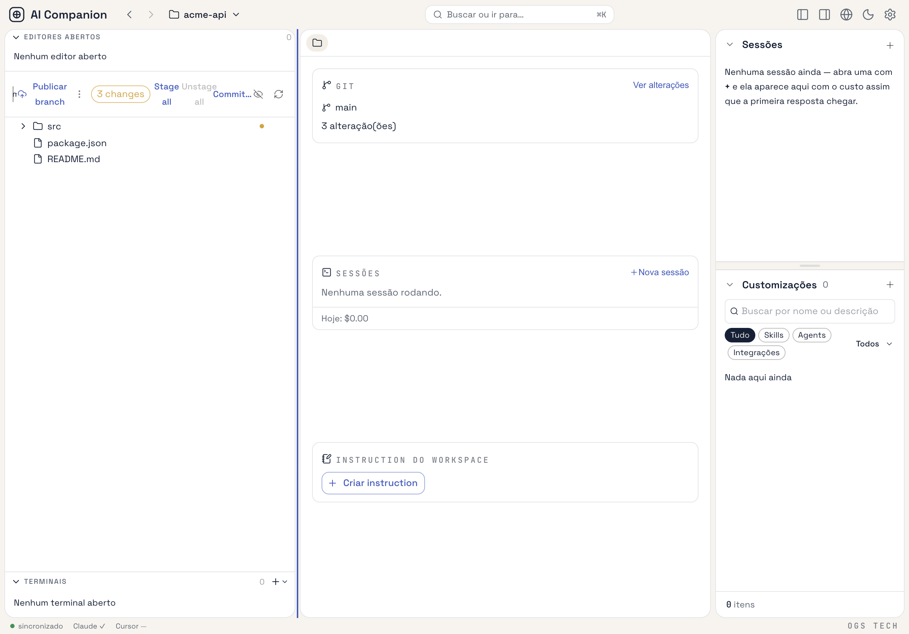
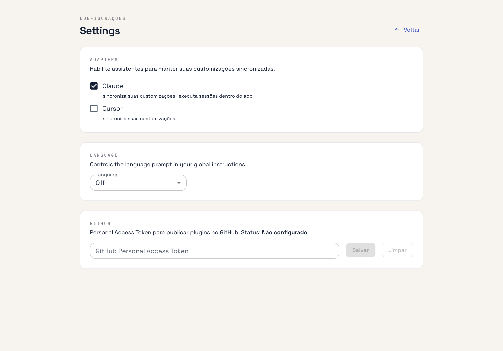

# Getting started

> **Audience:** first-time user with Node.js and Git installed.
> **Outcome:** the app is running on your machine with its default workspace set up.

## Prerequisites

- macOS (macOS-only today — the `.numbers` preview drives Numbers.app over Apple events).
- Node.js 22+ and npm.
- Git.
- The [`claude` CLI](https://docs.claude.com/en/docs/claude-code), installed and signed in — needed for sessions and history, not for managing customizations.

## 1. Clone and install

```bash
git clone https://github.com/ogs-tech/ai-companion.git
cd ai-companion
npm install
```

## 2. Run in development

```bash
npm run dev
```

`electron-vite` boots the main and preload bundles, starts Vite for the renderer, and opens an Electron window.

### Launch without `cd` into the repo

From the repo root, install the Mac dev shortcut once:

```bash
npm run install:dev-shortcut
```

This registers the global CLI **`ai-companion-dev`** and installs **`/Applications/AI Companion Dev.app`** (or `~/Applications/` if `/Applications` is not writable). Finder opens on the app after install — drag it to the Dock.

Clicking the Dock icon while dev is already running focuses the open window. Dev starts in the background (no Terminal window). **Right-click** the Dock icon → **Open Terminal** to stream logs — closing that Terminal does **not** stop dev. Use **Quit AI Companion Dev** (Dock menu or ⌘Q on the launcher) to stop the project.

If you installed the shortcut before this behavior existed, rerun `npm run install:dev-shortcut` once to refresh the launcher.

Then from anywhere in Terminal:

```bash
ai-companion-dev
```

## 3. First launch

There is no setup wizard. On first launch the app:

1. Creates its data dir, `~/.ai-companion/` (renaming a legacy `~/.superset-ai-app/` if one exists).
2. Writes default settings: Claude Code sync **on**, Cursor sync **off**.
3. Registers the official plugin marketplace.

It then opens on **Início** — the Global context. Início is not a workspace: it shows your personal
customizations, health and recent workspaces, and has no file tree or Git.



## 4. Open a folder

Click **Abrir pasta…** (or press **⌘O**) and pick a project folder. It becomes a **workspace**: the app
creates `<folder>/.ai-companion/` inside it and switches to it.



You now see the folder's file tree with Git status on the left, the workspace overview in the middle and
your sessions and customizations on the right.



## 5. Verify

You're ready when:

- The context switcher in the TopNav shows the folder's name, and the **Visão geral** tab lists **Git**,
  **Sessões** and **Instruction do workspace** cards.
- **Settings** (gear icon) → **Adapters** shows Claude switched on.

  

- `ls ~/.ai-companion` lists `settings.json` and `workspaces.json`; skills and agents appear under
  `skills/` and `agents/` once you create a personal one.

## What's next

- Follow [Your first skill, end to end](first-skill-end-to-end.md) — create a skill, see it land in
  `~/.claude/`, and use it from a session.
- Browse the [how-to guides](../index.md#how-to--task-oriented) for specific tasks.
- Read the [architecture reference](../reference/architecture.md) to understand the layers underneath.

## Troubleshooting

- **Window doesn't open** — check that no other process is holding port **47173** (dev renderer; see `electron.vite.config.ts`) and rerun `npm run dev`.
- **I/O error screen** — the app could not create or read `~/.ai-companion/` (permissions, a file in its place, …). Fix the cause, then use the screen's retry button.
- **`npm test` fails to load `node-pty` after running the app** — `npm run dev`/`npm run build` rebuild `node-pty` for Electron's Node ABI. Run `npm install` (or `npm rebuild node-pty`) to restore the host build before testing.
- **Stale build artifacts** — delete `out/` and rerun.
